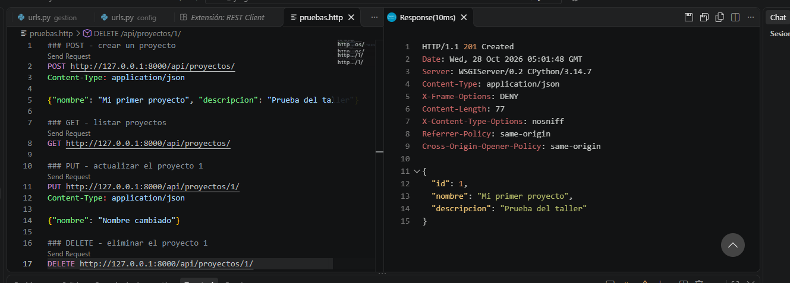
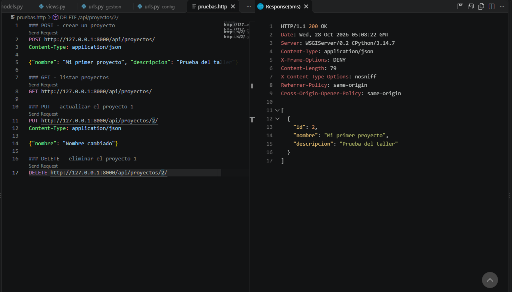
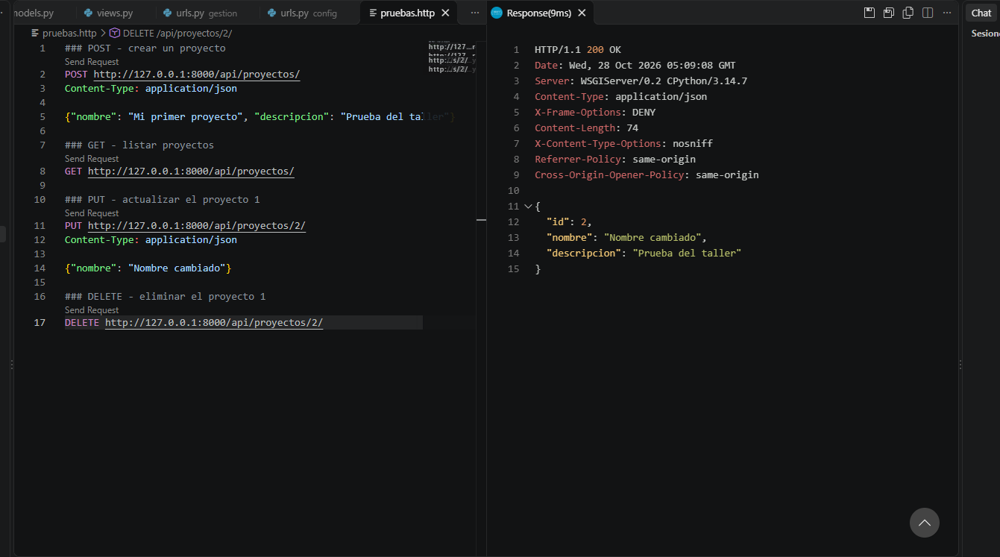
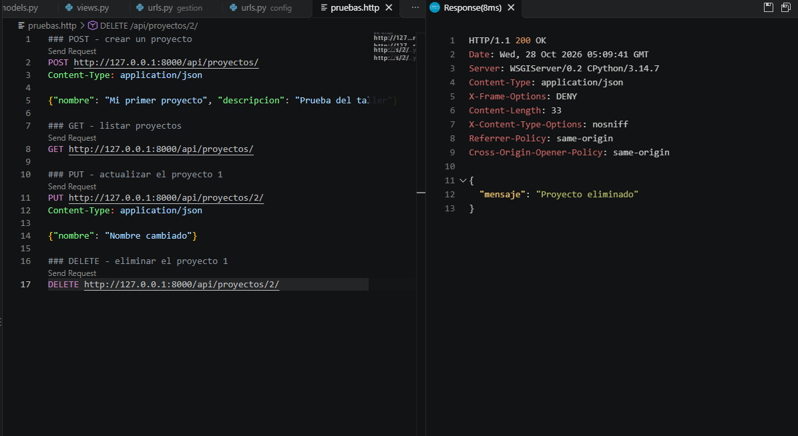

# Investigación: cómo crear endpoints en Django nativo

**Curso:** Desarrollo de aplicaciones Web I - 4E
**Docente:** Jose Javier Torres Vanstrahlen

## 1. Introducción

En este taller investigué cómo se crean endpoints en Django sin usar
librerías externas (por ejemplo, sin Django REST Framework). Un endpoint es
una dirección (URL) a la que se le puede hacer una petición para obtener,
guardar, cambiar o borrar datos. Lo que aprendí es que en Django todo
endpoint depende de dos archivos: `views.py`, donde está la lógica, y
`urls.py`, donde se conecta la URL con esa lógica.

## 2. Cómo funciona una vista basada en clase

Una vista basada en clase se crea heredando de `View`. Lo interesante es que
Django mira qué verbo HTTP trae la petición y ejecuta el método de la clase
que se llame igual. Si llega un GET ejecuta `get()`, si llega un POST
ejecuta `post()`, y así con `put()` y `delete()`. Si el método no existe,
Django responde solo con un error 405 (método no permitido).

Esto me pareció más ordenado que usar funciones, porque todo lo de un mismo
recurso (en mi caso `Proyecto`) queda dentro de una sola clase.

## 3. Los cuatro verbos HTTP y su relación con el CRUD

CRUD son las cuatro operaciones básicas sobre los datos: crear, leer,
actualizar y eliminar. Cada verbo HTTP corresponde a una:

| Verbo | CRUD | Para qué se usa | Respuesta típica |
|---|---|---|---|
| GET | Read (leer) | Pedir datos, ya sea la lista completa o un solo registro | 200 |
| POST | Create (crear) | Enviar datos para guardar un registro nuevo | 201 |
| PUT | Update (actualizar) | Enviar datos para modificar un registro que ya existe | 200 |
| DELETE | Delete (eliminar) | Borrar un registro | 200 |

Algo que noté al probarlo: GET y POST usan la URL `/api/proyectos/`, pero
PUT y DELETE necesitan el id del registro en la URL, por ejemplo
`/api/proyectos/2/`, porque tienen que saber cuál registro modificar o
borrar.

## 4. Módulos, funciones y decoradores que usé

| Elemento | Qué es | Para qué sirve |
|---|---|---|
| `View` (`django.views`) | Clase | Es la clase base de las vistas. Reparte la petición al método según el verbo |
| `as_view()` | Método | Convierte la clase en una vista que `path()` pueda usar |
| `dispatch()` | Método | Es el que decide qué método ejecutar (get, post, put o delete) |
| `JsonResponse` (`django.http`) | Clase | Devuelve la respuesta en formato JSON. Con `safe=False` se pueden enviar listas |
| `request.body` | Atributo | Trae los datos que envía el cliente, en bruto |
| `json.loads()` | Función | Pasa ese JSON a un diccionario de Python para poder usarlo |
| `csrf_exempt` (`django.views.decorators.csrf`) | Decorador | Quita la verificación CSRF. Sin él, Django bloquea POST, PUT y DELETE hechos desde herramientas externas con error 403 |
| `method_decorator` (`django.utils.decorators`) | Función | Permite usar un decorador normal dentro de una clase |
| `get_object_or_404` (`django.shortcuts`) | Función | Busca un registro y, si no existe, devuelve error 404 |
| `model_to_dict` (`django.forms.models`) | Función | Convierte un registro del modelo en diccionario, para poder mandarlo como JSON |
| `objects.values()` | Método del modelo | Trae todos los registros como diccionarios |
| `objects.create()` | Método del modelo | Crea y guarda un registro nuevo |
| `path()` (`django.urls`) | Función | Conecta una URL con una vista. `<int:pk>` captura el id |
| `include()` (`django.urls`) | Función | Trae las URLs de una app al `urls.py` principal del proyecto |

## 5. Archivos que modifiqué

- `gestion/views.py`: aquí está la clase `ProyectoView` con los cuatro
  métodos.
- `gestion/urls.py`: lo tuve que crear, porque Django no lo genera solo
  al crear la app. Tiene las dos rutas del endpoint.
- `config/urls.py`: le agregué `include("gestion.urls")` para conectar la
  app con el proyecto.

## 6. Pruebas

Probé los cuatro verbos con la extensión REST Client de VS Code, usando el
archivo `pruebas.http`. Primero hice un POST para crear un proyecto, luego
un GET para verlo, un PUT para cambiarle el nombre y por último un DELETE
para eliminarlo.

**POST (crear):**

**GET (leer):**

**PUT (actualizar):**

**DELETE (eliminar):**

## 7. Dificultades y conclusión

Lo que más me costó entender fue por qué hay que usar `csrf_exempt`: Django
protege por defecto los formularios contra ataques CSRF, y eso bloquea las
peticiones que no vienen de una página de Django. Usé el decorador para
poder hacer las pruebas, pero entendí que en un proyecto real el endpoint
debería protegerse con autenticación.

En conclusión, Django permite hacer endpoints sin librerías externas con
pocas herramientas: una clase que hereda de `View`, `JsonResponse` y las
rutas en `urls.py`. Además, se ve claro cómo cada verbo HTTP corresponde a
una operación del CRUD.

## 8. Fuentes consultadas

- Documentación de Django, vistas basadas en clase:
  https://docs.djangoproject.com/en/stable/topics/class-based-views/intro/
- Documentación de Django, HttpRequest, HttpResponse y JsonResponse:
  https://docs.djangoproject.com/en/stable/ref/request-response/
- Documentación de Django, protección CSRF:
  https://docs.djangoproject.com/en/stable/howto/csrf/
- MDN, métodos de petición HTTP:
  https://developer.mozilla.org/es/docs/Web/HTTP/Methods